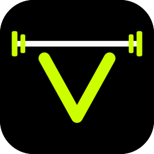
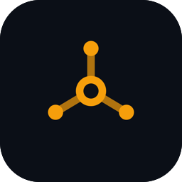
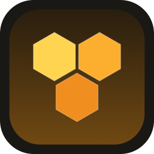
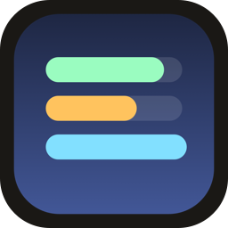

High school student interested in business, technology and investing. I experiment with code, and what interests me most is software and building companies around it. Cofounder of CustomWeb AI and VBar. Founder of CoreSpoke.

## Companies

<table>
  <tr>
    <td width="88" align="center"></td>
    <td><a href="https://github.com/CustomWeb-AI"><b>CustomWeb AI</b></a> AI phone agents for local businesses.</td>
  </tr>
  <tr>
    <td align="center"></td>
    <td><a href="https://github.com/VBar-fit"><b>VBar</b></a> A coaching app for fitness coaches, as a web app and an iPhone app.</td>
  </tr>
  <tr>
    <td align="center"></td>
    <td><a href="https://github.com/CoreSpoke"><b>CoreSpoke</b></a> (beta) Developer tools under one roof: KeepAlive, Simplify API, LLM Router, Dispatch and Flows.</td>
  </tr>
</table>

## Open source

<table>
  <tr>
    <td width="88" align="center"></td>
    <td><a href="https://github.com/jonathanbrantner/HiveMac"><b>HiveMac</b></a> (beta) A native macOS macro for Bee Swarm Simulator. Written in Swift, built to be light and optimized.</td>
  </tr>
  <tr>
    <td align="center"></td>
    <td><a href="https://github.com/jonathanbrantner/lanes"><b>Lanes</b></a> Menu bar monitor for RAM and external SSD speed. Built to be as light as possible.</td>
  </tr>
</table>

## Tools I use

        
